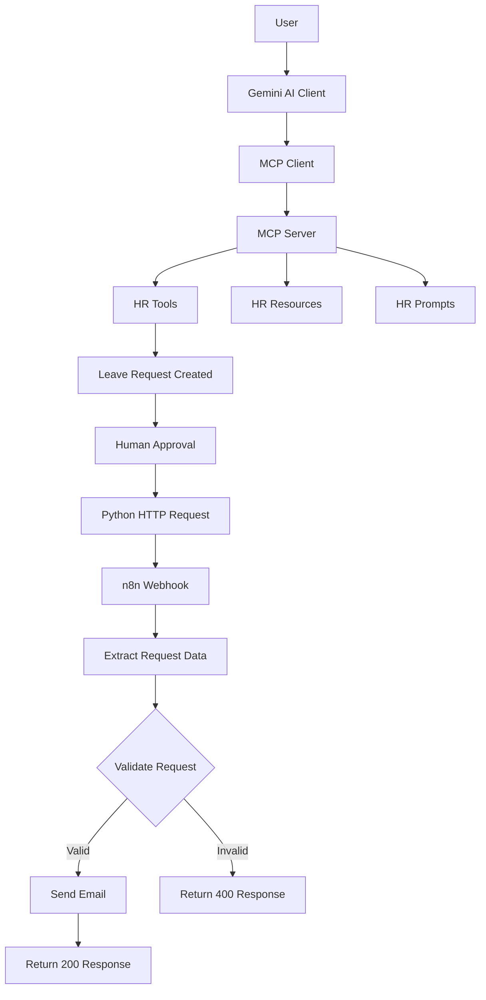

# Company HR Assistant — MCP + n8n Integration

An AI-powered HR assistant built using **Python, Gemini, Model Context Protocol (MCP), and n8n**. The project demonstrates how an AI assistant can interact with HR tools through MCP while using n8n for workflow automation, validation, and notifications.

## 🚀 Overview

The Company HR Assistant allows users to interact with HR functionalities through a Gemini-powered AI client.

The application uses MCP to expose HR tools, resources, and prompts to the AI client. Once a leave request is successfully created, the Python client sends the result to an n8n webhook, where the request is processed through an automated workflow.

The project also includes independent webhook and bridge testing scripts to verify communication between Python and n8n.

## 🏗️ Architecture



## 🛠️ Tech Stack

| Technology                   | Purpose                                                    |
| ---------------------------- | ---------------------------------------------------------- |
| Python                       | Core application logic                                     |
| Google Gemini                | AI-powered interaction                                     |
| Model Context Protocol (MCP) | Standardized communication between AI clients and HR tools |
| n8n                          | Workflow automation and orchestration                      |
| Requests                     | HTTP communication with n8n webhooks                       |
| python-dotenv                | Environment variable management                            |
| Git & GitHub                 | Version control                                            |

## ✨ Features

### 1. Gemini-Powered HR Assistant

- Interacts with users through a natural language interface.
- Identifies relevant HR tools based on user requests.
- Uses Gemini to process requests and generate responses.

### 2. MCP Server

Exposes HR functionality through MCP.

**Available tools:**

- `get_employee_details` — Retrieves employee information.
- `calculate_leave_balance` — Retrieves the remaining leave balance.
- `create_leave_request` — Creates a leave request.

**Additional MCP capabilities:**

- HR leave policy resource.
- Leave eligibility explanation prompt.

### 3. Human-in-the-Loop Approval

- Requires explicit user confirmation before executing leave-request creation.
- Prevents the application from executing the protected action without approval.

### 4. Client-Side Validation

- Validates leave request arguments.
- Checks date formats.
- Ensures the end date is not earlier than the start date.
- Rejects empty or placeholder reasons.

### 5. n8n Workflow Automation

After successful leave-request creation, the Python client sends the MCP result to an n8n webhook.

The n8n workflow:

1. Receives the incoming HTTP POST request.
2. Extracts employee and leave-request information.
3. Validates required fields.
4. Checks whether the request status is `Pending`.
5. Routes valid requests to the email notification node.
6. Returns an HTTP 200 response for successful processing.
7. Returns an HTTP 400 response for invalid requests.

### 6. Independent Testing Scripts

Two additional scripts are included:

- `test_webhook.py` — Tests the HR leave-request webhook independently.
- `mcp_n8n_bridge_test.py` — Tests the Python-to-n8n bridge using an MCP-style result payload.

## 📁 Project Structure

```text
Company-HR-MCP-Server/
│
├── server.py
├── client.py
│
├── test_webhook.py
├── mcp_n8n_bridge_test.py
│
├── requirements.txt
├── .env
├── .env.example
├── .gitignore
│
└── README.md
```

| File                     | Description                                                                                      |
| ------------------------ | ------------------------------------------------------------------------------------------------ |
| `server.py`              | Defines the MCP server, HR tools, resource, and prompt.                                          |
| `client.py`              | Connects Gemini with the MCP server and handles tool execution, approval, and n8n communication. |
| `test_webhook.py`        | Independently tests the HR leave-request webhook.                                                |
| `mcp_n8n_bridge_test.py` | Tests the Python-to-n8n integration.                                                             |
| `requirements.txt`       | Contains project dependencies.                                                                   |
| `.env`                   | Stores API keys and webhook configuration.                                                       |

## 📚 Learning Outcomes

Through this project, I explored and implemented:

- Building an MCP server using Python.
- Connecting an MCP client with Google Gemini.
- Exposing tools, resources, and prompts through MCP.
- Implementing human-in-the-loop approval.
- Validating tool arguments before execution.
- Integrating Python applications with n8n using HTTP webhooks.
- Building conditional automation workflows in n8n.
- Testing webhook communication independently.
- Managing application configuration using environment variables.

## 🔮 Future Improvements

- Implement persistent employee and leave-request storage.
- Add employee authentication and role-based authorization.
- Introduce remote MCP transport using Streamable HTTP.
- Add webhook authentication and secure communication.
- Implement retry mechanisms and structured error handling.
- Maintain an audit log of leave-request operations.
- Deploy the MCP server and integrate it with a remote MCP client.

## 👨‍💻 Author

**Inderjot Singh**

- GitHub: [InderjotSingh17](https://github.com/InderjotSingh17)
- LinkedIn: [Inderjot Singh](https://www.linkedin.com/in/inderjot-singh-0471a6237)

---

⭐ If you find this project interesting, feel free to explore the repository and share your feedback.

**Built with Python, Gemini, MCP, and n8n.**
